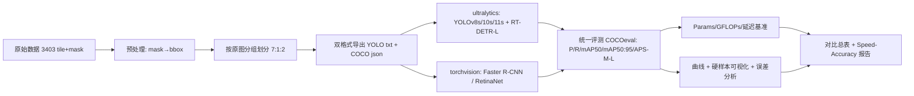

# 作业二：目标检测多架构对比训练与评测

### 1. 任务背景与目标

掌握目标检测的主流技术流派，深入理解单阶段无锚框/有锚框网络、两阶段候选区域网络以及基于 Transformer 的端到端检测架构，熟练掌握标注数据转换、模型训练调优与综合指标评估。

### 2. 数据集

建筑裂缝数据集：[https://github.com/guoguolord/crackDataset](https://github.com/guoguolord/crackDataset)

### 3. 具体实现要求

对数据集进行预处理，并在相同数据集和软硬件基准下，完整训练并对比不少于 **5 个**目标检测模型，必须覆盖以下三大技术流派：

- **YOLO 单阶段系列（至少选择 2 个）：** 如 YOLOv5、YOLOv8、YOLOv10、YOLOv11 等不同世代版本（规格推荐选用 s 或 m 级别）
- **两阶段经典检测网络（至少选择 1 个）：** Faster R-CNN（Backbone 选用 ResNet-50-FPN）
- **基于 Transformer 的端到端架构（至少选择 1 个）：** DETR、Deformable-DETR 或实时端到端模型 RT-DETR
- **其他对比模型（补足 5 个）：** 如 RetinaNet、SSD 或不同尺度参数的 YOLO 架构

### 4. 提交物与报告评测标准

- **定量指标：** 必须详细统计并记录 Precision（精准率）、Recall（召回率）、mAP@0.5、mAP@0.5:0.95、参数量（Params / M）、计算量（GFLOPs）以及单张推理时延（Latency / ms 或 FPS）
- **模型日志：** 完整的模型训练超参数配置文件与日志（Loss 曲线、PR 曲线、mAP 变化曲线）
- **对比表格：** 5 个模型的综合性能横向对比表格
- **可视化对比：** 典型测试样本的可视化推理对比图（重点分析小目标、重叠目标、强反光/低对比度场景下的检出与误检情况）
- **对比分析报告：** 总结单阶段卷积网络、两阶段网络与 Transformer 架构在精度与速度权衡（Speed-Accuracy Trade-off）上的本质差异

---

# 附：实施指南（Handout）

> 本部分基于对数据仓库的实测勘察（GitHub `main` 分支文件树 + 抽样下载）与各模型官方文档整理，可直接照做。勘察时间：2026-10-03。

### 5. 数据集实况勘察（动手前必读）

爬取仓库文件树实测：共 **3,403 对「图片 + 掩码」**（jpg + png 成对），结构如下：

| 子目录                            | 数量        | 掩码位置                | 实测样本尺寸                | 文件名规律（重要）                                                                                                  |
| --------------------------------- | ----------- | ----------------------- | --------------------------- | ------------------------------------------------------------------------------------------------------------------- |
| `crack500/train` + `crack500/val` | 1,517 + 379 | `label/` + `val_label/` | 640×360（边缘 tile 被裁小） | `20160222_081011_1281_721.jpg` = 原图 `20160222_081011` 在偏移 (x=1281, y=721) 处的 tile                            |
| `AsphaltCrack300/train`           | 795         | `label/`                | 504×672                     | `001_04.jpg` = 原图 `001` 的第 04 块 tile（原图 3024×4032）                                                         |
| `CFD/train` + `CFD/val`           | 566 + 146   | `label/` + `val_label/` | 480×320                     | `025.jpg` 为原图；`025_1 / 025__1 / 025add1 / 025adjust1 / 025sub1` 是**同一张原图的增广副本**（翻转 / 亮度增减等） |

三个决定预处理方案的关键事实：

1. **标注是像素级掩码，不是检测框。** 掩码 PNG 实测混有 1-bit 二值（像素值 0/1，不是 0/255）和 8-bit 调色板两种编码，必须自己转 bbox——这是本作业预处理的核心工作量。
2. **仓库里的"一张图"≠ 一个独立样本。** 3,403 个 tile 按命名规则还原自约 918 张原图（Crack500 500 张、AsphaltCrack300 300 张、CFD 118 张）。**划分 train/val/test 必须按"原图 ID"分组切分**，否则同一原图的不同 tile 跨集合，造成数据泄漏、指标虚高——这是本作业最容易踩、也最容易被查出的坑。
3. **三个子集分辨率与拍摄条件差异大**（640×360 / 504×672 / 480×320）。训练统一 letterbox 到 640；评测口径（COCO API）与输入尺度（640×640）对所有模型强制一致。

数据集出处（写报告引用用）：Crack500 出自 Yang et al., _Feature Pyramid and Hierarchical Boosting Network for Pavement Crack Detection_, IEEE T-ITS 2020；CFD（Crack Forest Dataset）出自 Shi et al., _Automatic Road Crack Detection Using Random Structured Forests_, IEEE T-ITS 2016；AsphaltCrack300 为仓库作者自采（南京信息工程大学无锡研究院周边路段）。

### 6. 技术路线总览



七步走：预处理 → 双格式导出 → 分组划分 → 两套框架训练 6 个模型 → 统一评测 → 可视化与误差分析 → 报告。

### 7. 推荐模型组合（6 个，超额覆盖全部硬性要求）

| #   | 模型                 | 流派                             | 框架        | 预训练权重                          | 官方 COCO 参考（640 输入）                       |
| --- | -------------------- | -------------------------------- | ----------- | ----------------------------------- | ------------------------------------------------ |
| 1   | YOLOv8s              | 单阶段 anchor-free               | ultralytics | `yolov8s.pt`                        | 11.2M / 28.6 GFLOPs / 44.9 AP                    |
| 2   | YOLO11s              | 单阶段 anchor-free               | ultralytics | `yolo11s.pt`                        | 9.4M / 21.6 GFLOPs / 47.0 AP                     |
| 3   | YOLOv10s             | 单阶段 NMS-free（双分配）        | ultralytics | `yolov10s.pt`                       | 7.2M（融合后）/ 21.6 GFLOPs / 46.3 AP            |
| 4   | Faster R-CNN R50-FPN | 两阶段                           | torchvision | `fasterrcnn_resnet50_fpn` COCO 权重 | ≈41.5M（以实测为准）                             |
| 5   | RetinaNet R50-FPN    | 单阶段 anchor-based + Focal Loss | torchvision | `retinanet_resnet50_fpn` COCO 权重  | ≈34M（以实测为准）                               |
| 6   | RT-DETR-L            | Transformer 端到端               | ultralytics | `rtdetr-l.pt`                       | 53.0 AP / 114 FPS(T4)（R50 版 42M / 136 GFLOPs） |

选型理由：**两套框架覆盖 6 个模型**，工程量最小；规格全部 s 级 / R50 级，参数量带可比性。若坚持原版 DETR / Deformable-DETR 需引入 mmdetection 或独立官方仓库，小数据集上收敛慢、环境成本高，不建议（可在报告讨论部分提及）。两框架训练机制差异要如实写进报告，但评测统一走 COCO API，公平性不受影响。

### 8. 阶段一：预处理与格式转换

#### 8.1 mask → bbox（核心脚本 `tools/mask2bbox.py`）

推荐方案 A（一个连通域一个框）：

1. 读掩码并二值化：`arr = np.array(im)`，统一用 `arr > 0`（兼容 1-bit 的 0/1 值、0/255 值、调色板索引；**不要写 `==255`**）。
2. **目检**：随机抽 10 张，掩码叠加原图存 PNG 人工看一遍——调色板编码的掩码可能把裂缝画成深色，必须确认二值化方向没反。
3. 形态学闭运算（3×3 核，1–2 次迭代）桥接裂缝断裂处。
4. `cv2.connectedComponentsWithStats` 取每个连通域的外接框；过滤 `area < 64 px` 消标注噪点。
5. 同时输出两种格式：COCO `[x1,y1,w,h]`（绝对像素）与 YOLO `xc,yc,w,h`（归一化）。

可选加分消融：细长裂缝单个外接框的 IoU 天花板很低——对比「整条裂缝一个框」vs「把长条按网格切碎成多框」两种转框策略对 mAP@0.5:0.95 的影响。

#### 8.2 数据统计（`tools/analyze.py`，产出写进报告第 2 章）

- 每图实例数分布、box 长宽比分布（裂缝极度细长，直接影响 anchor 适用性与 mAP 上限，是报告的分析亮点）
- COCO 口径目标尺寸分桶占比：小 `<32²` / 中 `32²–96²` / 大 `>96²`（对应 `AP_S / AP_M / AP_L`，为"小目标分析"提供数据）

#### 8.3 按原图分组划分（`tools/split.py`）

- 分组键：crack500 用 `^(.*)_.*?_\d+_\d+$` 类正则取原图名；AsphaltCrack300 取 `^(\d+)_`；CFD 取 `^(\d+)`（add/sub/adjust/翻转变体归入同一原图组）
- 比例 **7:1:2**（test 留足统计效力），按三个子集分层抽样，固定 `seed=0`，清单落盘 `splits/{train,val,test}.txt`
- 转框后变空的 tile **保留为背景图**（YOLO 侧写空 label 文件），有助于压误检

#### 8.4 目录规划

```
data/
  yolo/{images,labels}/{train,val,test}/   # ultralytics 用
  coco/annotations/{train,val,test}.json   # torchvision 训练 + 全模型统一评测用
  crack.yaml                               # path/train/val/test/names: ['crack']
```

### 9. 阶段二：环境（一次性配置，记入报告附录）

| 组件        | 建议                                                              |
| ----------- | ----------------------------------------------------------------- |
| Python      | 3.10+                                                             |
| PyTorch     | ≥2.3 + 本机 GPU 对应 CUDA 版本                                    |
| ultralytics | ≥8.3（一个包含 YOLOv8 / v10 / 11 与 RT-DETR）                     |
| torchvision | 与 torch 版本配套                                                 |
| 评测工具    | pycocotools、opencv-python、thop（或 fvcore）、matplotlib、pandas |

同时记录硬件基线：`nvidia-smi`（GPU 型号 / 显存 / 驱动）、torch / cudnn 版本。**所有模型的延迟测试必须在同一台机器、同一状态下完成。**

### 10. 阶段三：统一训练基准

原则：输入尺度、batch、epoch 预算、数据增强、随机种子全部对齐——**统一 batch=16 + 统一 epochs=150**，使六个模型的梯度步数与数据通过次数同时相等（train ≈ 2.4k 张 → ~149 iter/epoch → ~22.3k 步/模型），并以 patience=50 早停 + 保存 val 最优权重兜底，保证无模型欠训练；框架差异如实记录。

**lr 政策**：各模型使用其「优化器 × 框架」的规范默认值（torchvision 侧 SGD lr=0.005，ultralytics 侧框架 auto 默认并在 args.yaml 留档，RT-DETR 用默认 AdamW），**不逐模型调参**。lr 数值不跨优化器可比（AdamW 自适应归一化梯度，典型 1e-4~1e-3；SGD 典型 1e-2），强行统一数值反而偏袒某一族。仅两种例外允许动 lr：① batch 因显存降级时按缩放规则补偿（SGD 线性缩放，AdamW 不动）；② 训练发散（loss NaN / 明显欠拟合）时的修复——修复属于"保证每个模型被合格训练"的义务，须在报告中记录。

| 模型                 | imgsz    | batch    | epochs | 优化器 / lr                                        | 关键设置                                                                                                                                  |
| -------------------- | -------- | -------- | ------ | -------------------------------------------------- | ----------------------------------------------------------------------------------------------------------------------------------------- |
| YOLOv8s / v10s / 11s | 640      | 16       | 150    | 框架默认（auto，args.yaml 留档）                   | COCO 预训练微调，`mosaic=1.0, close_mosaic=10, seed=0, patience=50`                                                                       |
| RT-DETR-L            | 640      | 16       | 150    | 默认 AdamW                                         | COCO 预训练微调；`deterministic=False` 提速（官方建议，deformable attention 无确定性反向）；六者中最吃显存，OOM 则降 batch=8 并在报告记录 |
| Faster R-CNN R50-FPN | 短边 640 | 16 + AMP | 150    | SGD lr=0.005, momentum=0.9, cosine + 500 iter 热身 | 预测头改 `num_classes=2`（背景+crack），全网络微调；OOM 则 batch=8 且 lr 减半（线性缩放规则），并记录                                     |
| RetinaNet R50-FPN    | 短边 640 | 16 + AMP | 150    | 同上                                               | Focal Loss α=0.25 / γ=2.0 默认；降级规则同上                                                                                              |

ultralytics 侧命令（逐个替换 model 与 name）：

```bash
yolo train model=yolo11s.pt  data=data/crack.yaml epochs=150 imgsz=640 batch=16 seed=0 patience=50 project=runs name=yolo11s
yolo train model=rtdetr-l.pt data=data/crack.yaml epochs=150 imgsz=640 batch=16 seed=0 project=runs name=rtdetr_l
```

torchvision 侧：按官方 _TorchVision Object Detection Finetuning Tutorial_ 改数据集加载器读 COCO json，训练循环每 epoch 在 val 上算 COCO 指标并存 CSV。

日志要求（对应提交物）：ultralytics 自动产出 `args.yaml / results.csv / 曲线`；torchvision 自记 `log.csv`（各 loss 分量 + val mAP@0.5 / mAP@0.5:0.95）。最终所有曲线统一重绘进报告。

### 11. 阶段四：统一评测协议（公平性命门）

1. **指标**：所有模型预测转 COCO json，在**同一份 test 集**上用同一个 `pycocotools COCOeval` 计算 mAP@0.5、mAP@0.5:0.95（`max_det=300`、score 阈值 0.05 起评，COCO 标准口径）；另报 conf=0.25 应用阈值下的 P / R（工程口径）。RT-DETR 推理上限即 300 queries，天然对齐。
2. **参数量 / GFLOPs**：统一 640×640 输入。ultralytics 用 `model.info()`；torchvision 用 `thop.profile`。YOLOv10 融合前后参数量不同（官方脚注），报告注明口径。
3. **时延**：GPU、batch=1、预热 50 次、正式计时 300 次取均值±标准差，`torch.cuda.synchronize()` 掐表；FP32 与 FP16（autocast）分开报；是否含预处理 / NMS 后处理必须写明；FPS = 1000 / latency。
4. **产出**：`results/summary.csv` → 作业要求的横向对比总表。

### 12. 预期结果（预注册假设，实验后对照验证）

裂缝为单类、细长、低对比度目标，COCO 预训练模型迁移效果通常不错。**预期数值区间**（640 训练、上述协议；报告用实测值替换并对照讨论）：

| 模型             | mAP@0.5 预期 | mAP@0.5:0.95 预期                                | 相对延迟         |
| ---------------- | ------------ | ------------------------------------------------ | ---------------- |
| YOLOv8s          | 0.85–0.93    | 0.40–0.55                                        | 快               |
| YOLOv10s         | 0.84–0.92    | 0.40–0.55                                        | 最快档（无 NMS） |
| YOLO11s          | 0.86–0.94    | 0.42–0.58                                        | 最快档           |
| Faster R-CNN R50 | 0.80–0.90    | 0.38–0.55（框回归精修，高 IoU 段可能反超单阶段） | 最慢档           |
| RetinaNet R50    | 0.78–0.88    | 0.35–0.50                                        | 中慢             |
| RT-DETR-L        | 0.85–0.94    | 0.42–0.60（全局注意力对小目标友好）              | 中               |

预期规律（报告的讨论抓手）：

- **mAP@0.5 普遍偏高、mAP@0.5:0.95 明显偏低**：细长目标框稍偏 IoU 即崩，是数据集固有属性，也是 8.1 转框策略消融的动机。
- **GFLOPs ≠ 延迟**：Faster R-CNN（稀疏 RoI 头）与 YOLO（稠密单 pass）的每 GFLOP 延迟差异大，加上 NMS 后处理差异——用速度-精度散点图找 Pareto 前沿，这是"本质差异"章节的核心论据。
- **NMS-free（v10、RT-DETR）vs NMS 系**在高重叠 / 密集裂缝场景的检出差异，正对应作业要求的"重叠目标"可视化分析。

### 13. 阶段五：可视化与误差分析

- **硬样本集**：从 test 集挑 ≥12 张并打场景标签（小目标 / 重叠 / 强反光·低对比度），固定清单 `eval/hard_samples.txt`，所有模型跑同一批。
- **并排渲染**（`tools/render_compare.py`）：GT + 6 模型同图网格，conf=0.25、统一框色。
- **误差分析**：每模型混淆矩阵；FP 归因（背景误检 / 定位差 IoU∈[0.1,0.5) / 重复框）；漏检按目标尺寸分桶——对应作业"检出与误检情况"要求。

### 14. 阶段六：报告结构模板

1. **引言与三种范式原理**（评分点）：两阶段 anchor-based（RPN 候选 + RoI 头）→ 单阶段 anchor-based（RetinaNet，Focal Loss 解类别失衡）→ 单阶段 anchor-free（v8/v11 解耦头）→ NMS-free（v10 一致双分配；DETR 集合预测 + 二分图匹配）
2. 数据集与预处理（第 8 节产出：统计图、转框规则、划分协议）
3. 实验设置（第 9/10 节表格 + 超参数文件）
4. 定量结果（对比总表 + Loss / PR / mAP 曲线）
5. 定性对比（第 13 节图 + 逐场景分析）
6. **Speed-Accuracy Trade-off 本质差异**（散点 + Pareto 前沿；GFLOPs 与实测延迟的偏离讨论：访存受限算子、NMS 后处理、两阶段串行开销）
7. 结论与改进方向
   附录：环境、复现命令、完整配置

### 15. 时间规划（3 周参考）

| 周  | 里程碑                                                                                                                                              |
| --- | --------------------------------------------------------------------------------------------------------------------------------------------------- |
| W1  | D1–2 数据下载 + mask→bbox + 目检；D3 分组划分 + 双格式导出 + 统计；D4–5 环境搭建，YOLOv8s 先跑通端到端（含评测脚本）；D6–7 其余 YOLO + RT-DETR 训练 |
| W2  | torchvision 两模型训练联调；统一评测 + 参数量/延迟基准；对比表初版                                                                                  |
| W3  | 硬样本可视化 + 误差分析；报告撰写；复跑抽查、打磨                                                                                                   |

### 16. 风险清单（每条带对策）

| 风险                              | 对策                                                            |
| --------------------------------- | --------------------------------------------------------------- |
| 划分泄漏（tile / 增广同源跨集合） | 按原图 ID 分组划分（8.3），这是最高优先级                       |
| 掩码编码混乱（1-bit 0/1、调色板） | 统一 `arr > 0` 二值化 + 抽样叠加目检                            |
| 细长目标 IoU 天花板低             | 预期管理 + 转框策略消融（加分项）                               |
| 原版 DETR 小数据不收敛            | 用 RT-DETR-L COCO 预训练替代原版 DETR                           |
| 显存不足                          | 降 batch + AMP；输入都是小图，640 训练压力不大                  |
| P / R 口径不清被扣分              | 报告写明 conf、IoU 阈值、max_det                                |
| 各框架自带指标对不齐              | 一律转 COCO json + 同一份 COCOeval                              |
| 结果不可复现                      | 固定 seed、保存全部配置（ultralytics 自动 args.yaml）、记录硬件 |

### 17. 交付物自查清单（对照作业第 4 节）

- [ ] 预处理脚本与说明（mask→bbox 规则、分组划分协议、统计图）
- [ ] 6 个模型各自的超参配置文件与训练日志（Loss / PR / mAP 曲线）
- [ ] 指标全集：Precision / Recall / mAP@0.5 / mAP@0.5:0.95 / Params(M) / GFLOPs / Latency(ms 或 FPS)
- [ ] 6 模型横向对比总表
- [ ] 硬样本可视化对比图（小目标 / 重叠 / 强反光·低对比度，含 GT）
- [ ] Speed-Accuracy Trade-off 对比分析（含 Pareto 散点图）
- [ ] 代码仓库 + README 复现步骤
